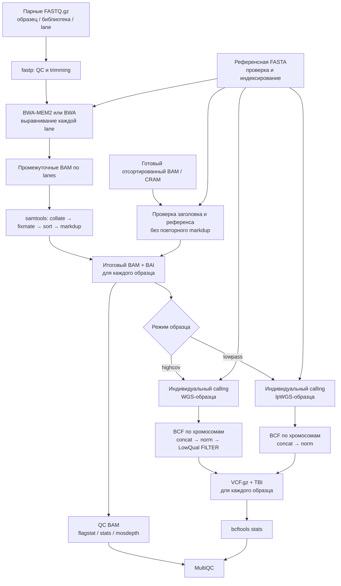
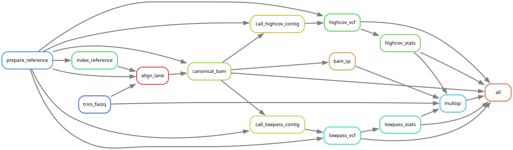

# Пайплайн для обработки WGS/lpWGS данных

**Livestock** — пайплайн для обработки полногеномного (WGS) и низкопокрытийного (lpWGS) секвенирования сельскохозяйственных животных. Принимает парные `FASTQ.gz` или готовые координатно отсортированные `BAM/CRAM` и создаёт **отдельные BAM и VCF для каждого образца**.

Используются **Snakemake 9**, **Slurm**, **Apptainer/Singularity**, **fastp**, **BWA-MEM2/BWA**, **SAMtools**, **BCFtools** и **MultiQC**. В текущей версии проверялись данные КРС и овец; дополнительные виды требуют подходящего референса и настройки конфигурации.

## Как устроена обработка



**Принцип работы:** каждый образец обрабатывается независимо. Даже если в одном запуске участвуют тысячи животных одного вида, пайплайн **не выполняет совместный variant calling и не объединяет их генотипы**. Общими могут быть референсные индексы и сводный отчёт MultiQC.

- Для `highcov` варианты вызываются отдельно по хромосомам одного образца; варианты с низким `QUAL` помечаются фильтром `LowQual` (порог задаётся в конфигурации).
- Для `lowpass` варианты также вызываются отдельно по образцу, **без импутации**. Отсутствие записи в таком VCF нельзя считать генотипом `0/0`.
- При импорте BAM/CRAM этапы `fastp` и выравнивания пропускаются. Входное выравнивание должно соответствовать выбранной FASTA, а политика маркировки дубликатов — быть определена заранее.

## Граф зависимостей Snakemake

Mermaid выше показывает общую логику. Следующие SVG генерируются **из действующего `Snakefile` и правил** для конкретной конфигурации:

**Граф правил:**



**[Открыть полный DAG заданий](docs/images/snakemake_dag.svg)** — детальная схема отдельных задач по образцам и хромосомам.

Для создания или обновления изображений:

```bash
bash scripts/generate_snakemake_graphs.sh config/demo_positive.yaml
```

Сначала нужно выполнить `python scripts/generate_positive_demo.py`, чтобы создать синтетические входные данные и указанный YAML. Для собственных данных вместо `config/demo_positive.yaml` укажите конфигурацию конкретного запуска. **После перехода на индивидуальные VCF старые SVG нужно перегенерировать:** иначе они могут показывать прежний совместный calling. [Подробнее о графах](docs/GRAPH_RU.md).

## Что получается на выходе

Для каждого образца `SAMPLE001`:

| Результат | Путь относительно настроенных каталогов |
|---|---|
| Итоговое выравнивание | `workdir/bam/SAMPLE001.bam` и `.bam.bai` |
| VCF с индексом, highcov | `results_dir/vcf/<species>/highcov/SAMPLE001.vcf.gz` и `.tbi` |
| VCF с индексом, lowpass | `results_dir/vcf/<species>/lowpass/SAMPLE001.vcf.gz` и `.tbi` |
| Контроль качества | `results_dir/qc/` |
| Время и ресурсы выполнения | `results_dir/benchmarks/` |

Образец относится только к **одному** режиму (`highcov` или `lowpass`), поэтому создаётся один из двух вариантов пути VCF. Промежуточные файлы `trimmed FASTQ` и `lane BAM` могут удаляться автоматически. **Итоговые BAM лежат в `workdir`, а не в `results_dir`**: на очищаемом scratch их необходимо отдельно сохранять вместе с индексами.

## Установка и запуск

- **Первое развёртывание:** [требования](docs/REQUIREMENTS_RU.md) → [установка окружения, контейнера и профиля](docs/INSTALL_RU.md).
- **Новый набор образцов на настроенном сервере:** подготовить YAML и TSV → проверить их → выполнить `dry-run` → запустить Snakemake. [Пошаговая инструкция](docs/INSTALL_RU.md).
- **Без выполнения анализа:** `python -m unittest discover -s tests -v` проверяет код и структуру проекта; `dry-run` проверяет план задач, но не создаёт BAM/VCF.

Копирование `config/config.yaml`, `config/samples.tsv` и `config/metadata.tsv` в новые файлы нужно **только при подготовке нового анализа**. Это шаблоны: их примеры не являются входными данными реального запуска.

## Документация

| Раздел | Содержание |
|---|---|
| [Требования](docs/REQUIREMENTS_RU.md) | Окружение, контейнер, Slurm, хранение данных |
| [Установка и запуск](docs/INSTALL_RU.md) | Настройка нового сервера и запуск следующих партий |
| [Конфигурация](docs/CONFIGURATION_RU.md) | YAML, `samples.tsv`, `metadata.tsv` и референсы |
| [Архитектура](docs/ARCHITECTURE.md) | Стадии обработки, параллелизм, ограничения |
| [Правила и скрипты](docs/RULES_AND_SCRIPTS_RU.md) | Назначение Snakemake-правил, скриптов и профилей |
| [Графы Snakemake](docs/GRAPH_RU.md) | Генерация rulegraph и полного DAG |
| [Выходные файлы](docs/OUTPUTS_RU.md) | BAM, VCF, QC, хранение результатов |
| [Проверки и тесты](docs/VALIDATION.md) | Unit-тесты, синтетический тест, пилот |
| [Обслуживание](docs/MAINTENANCE_RU.md) | Логи, возобновление, диагностика и ресурсы |

## Статус и ограничения

- **Не реализованы:** импутация, BQSR, вызов структурных вариантов (SV/CNV), sex-aware calling, объединение индивидуальных VCF и популяционно-генетический анализ. Индивидуальные VCF содержат вызванные варианты; отсутствие позиции в файле не доказывает референсный генотип.
